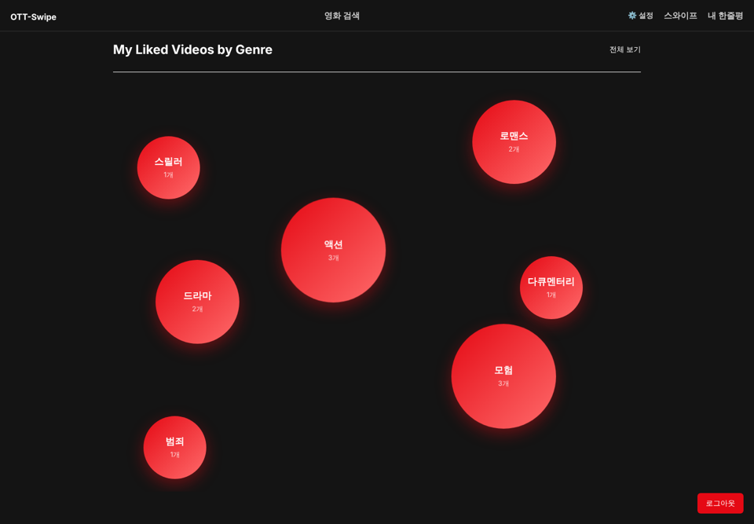
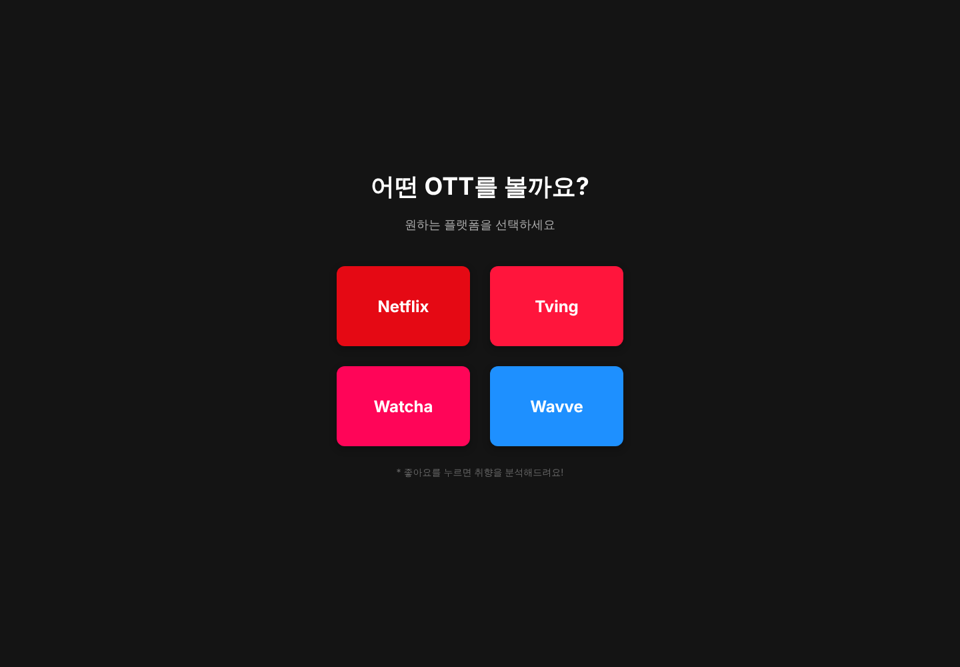
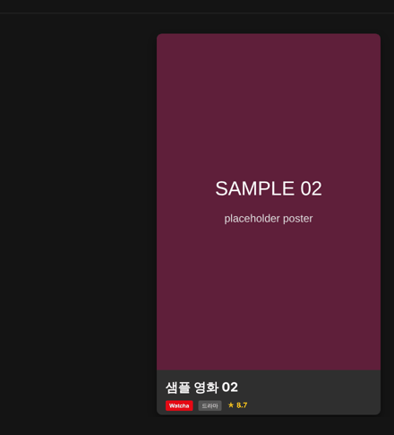
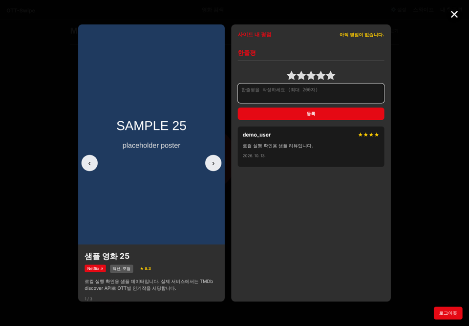
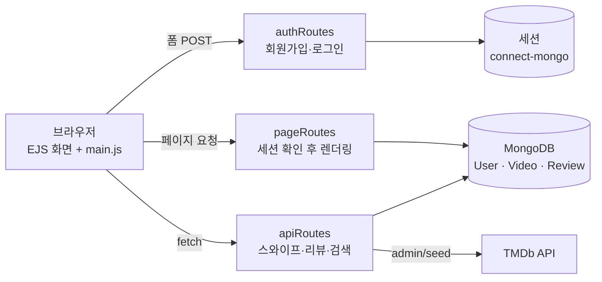

# OTT-Swipe · 취향 기반 OTT 영화 추천 웹서비스

카드를 좌우로 넘기며 영화를 고르면, 좋아요 기록이 장르별 취향 지도와 한줄평으로 쌓이는 웹서비스입니다.
Node.js · Express · MongoDB · EJS로 만든 **2인 팀 프로젝트**이며, 저는 **서버 골격, 회원 인증, TMDb 데이터 수집 파이프라인**을 맡았습니다.

<p align="center">
  
</p>

> 화면은 포트폴리오 정리 중(2026-10-13) Claude Code로 저장소 코드를 그대로 로컬 실행(Node 22, MongoDB 7)해 캡처했습니다. 캡처 환경에서 TMDb에 접속할 수 없어 **영화 데이터와 포스터는 샘플 데이터**입니다.

## 한눈에 보기

| 항목 | 내용 |
|---|---|
| 기간 | 2025.09 ~ 2025.12 (커밋 기록: 2025-11-18 ~ 2025-12-15) |
| 인원 | 2인 · [@junido7185](https://github.com/junido7185) (커밋 작성자명 `dev_slime`) · [@dain6812](https://github.com/dain6812) |
| 스택 | Node.js, Express 5, MongoDB(Mongoose 8), express-session + connect-mongo, bcryptjs, EJS, TMDb API |
| 기능 | 회원가입·로그인, OTT 선택, 좋아요/넘기기 스와이프, 장르별 모아보기, 별점 0.5 단위 한줄평, 영화 검색, 닉네임 |

## 역할 분담

`git blame` 기준으로 확인한 분담입니다. 공동 수정 파일은 주로 작성한 사람을 기준으로 적었습니다.

| 영역 | 담당 | 근거 |
|---|---|---|
| Express 서버 골격, DB 연결, 세션 설정 | **본인** | `app.js`, `config/dbConnect.js` |
| 회원가입·로그인·로그아웃 (bcrypt 해시, MongoDB 세션 저장소) | **본인** | `controllers/authController.js` 85줄 중 82줄 |
| 좋아요/넘기기·내 목록 API | **본인** | `controllers/userController.js` 101줄 중 68줄 |
| User·Video 스키마, 평점 필드 | **본인** | `models/User.js`, `models/Video.js` |
| TMDb 연동과 OTT별 데이터 시딩, 다음 영상 추천 쿼리 | **본인** | `controllers/videoController.js` 251줄 중 222줄 |
| 닉네임 페이지, 별점 반 개 단위, 한줄평→영상 바로가기, "내 취향 모아보기" | **본인** | 커밋 `ea6072e`, `72b33c1`, `e2ef188`, `b62e7da` |
| 드래그 스와이프 UI, OTT 선택 화면 | 팀원 | 커밋 `1d8a770`, `02fc279` |
| 한줄평 CRUD, 검색, 내 한줄평, 로그아웃 버튼(뷰) | 팀원 | `controllers/reviewController.js` 131줄 중 118줄, `views/my-list.ejs` L677 |
| 화면 스타일과 클라이언트 스크립트 | 공동 | `public/css/style.css`, `public/js/main.js` |

## 화면

| OTT 선택 | 카드 스와이프 | 한줄평 |
|---|---|---|
|  |  |  |

캡처 환경에서 TMDb에 접속할 수 없어 카드의 영화 정보와 포스터("SAMPLE NN / placeholder poster")는 샘플 데이터로 채웠습니다. 실제 서비스는 아래 시딩 API로 TMDb 데이터를 채웁니다.

## 핵심 구현

### 1. TMDb → MongoDB 시딩 파이프라인
`POST /api/admin/seed?limit=N` · [`controllers/videoController.js#L141-L225`](https://github.com/junido7185/ott-project/blob/6229b3f/controllers/videoController.js#L141-L225)

- 넷플릭스·왓챠·티빙·웨이브의 TMDb provider ID(8, 97, 119, 356)로 `discover/movie`를 한국 지역 기준으로 페이지를 넘기며 호출합니다.
- 줄거리나 포스터가 없는 항목은 건너뛰고, `tmdbId`를 키로 `updateOne(..., { upsert: true })` 합니다. 시딩을 여러 번 실행해도 중복 문서가 생기지 않습니다.
- 장르 ID→이름 변환표는 첫 호출 때만 TMDb에서 받아 메모리에 캐시합니다(`getGenreMap`, L12-L35).
- 무한 호출을 막기 위해 OTT마다 최대 49페이지까지만 요청합니다(`currentPage < 50`, L167).

### 2. 세션 기반 인증
[`controllers/authController.js`](controllers/authController.js) · [`app.js#L23-L29`](https://github.com/junido7185/ott-project/blob/6229b3f/app.js#L23-L29)

- 비밀번호는 `bcrypt.hash(password, 10)`으로 저장하고, 로그인 시 `bcrypt.compare`로 검증합니다.
- 세션은 `connect-mongo`로 MongoDB에 저장해 서버를 재시작해도 로그인이 유지되고, 쿠키 수명은 24시간입니다.

### 3. 이미 본 영상을 제외한 무작위 추천
[`controllers/videoController.js#L59-L97`](https://github.com/junido7185/ott-project/blob/6229b3f/controllers/videoController.js#L59-L97)

- 사용자의 `likedVideos`와 `passedVideos`를 합쳐 `$nin`으로 제외하고, OTT와 장르 조건을 붙입니다.
- `countDocuments` 후 무작위 `skip`으로 한 편을 고릅니다. 조건에 맞는 영상이 없으면 404로 끝을 알립니다.

### 4. 좋아요 기록으로 취향 장르 계산
[`controllers/pageController.js#L6-L42`](https://github.com/junido7185/ott-project/blob/6229b3f/controllers/pageController.js#L6-L42)

- 좋아요한 영상의 `"액션, 모험"` 같은 장르 문자열을 쪼개 집계하고, 가장 많은 장르를 OTT 선택 화면에 보여줍니다.

## 구조



## 실행 방법

Node.js 18 이상(내장 `fetch` 사용)과 MongoDB가 필요합니다.

```bash
npm ci
cp .env.example .env   # MONGO_URI, SESSION_SECRET, TMDB_API_KEY, ADMIN_TOKEN 입력
npm start              # http://localhost:3000

# 영화 데이터 채우기 (OTT별 20편)
curl -X POST -H "x-admin-token: $ADMIN_TOKEN" "http://localhost:3000/api/admin/seed?limit=20"
```

## 개발 방식

2025년 과제 기간의 커밋 기록에는 AI 공동 작성 표기가 없습니다. 이 README와 화면 캡처는 포트폴리오 정리 중(2026-10-13) Claude Code로 작성했습니다.

## 다시 보며 찾은 한계

포트폴리오용으로 코드를 다시 검토하면서 찾은 문제입니다. 과제 제출 당시에는 인지하지 못했습니다. "영향"까지는 과제 제출본(커밋 `6229b3f`) 기준이고, 줄 번호도 그 커밋 기준입니다.
앞의 두 항목은 제가 작성한 API(`userController.js`)의 문제입니다. 포트폴리오 정리 중(2026-10-13) Claude Code로 로컬 실행해, A 계정 세션으로 B 계정의 좋아요 목록을 바꾸는 요청이 성공하는 것을 재현했습니다.

두 OTT 중복 문제를 뺀 7가지는 [PR #2](https://github.com/junido7185/ott-project/pull/2)에서 고쳤습니다. 같은 검증 스크립트로 수정 전 코드는 36개 검사가 실패했고, 수정 후에는 58개가 모두 통과했습니다. 수정과 검증은 Claude Code로 했습니다.

| 문제 | 위치 | 영향 | 조치 |
|---|---|---|---|
| 좋아요/넘기기/내 목록 API가 URL의 `userId`를 그대로 신뢰 | `controllers/userController.js#L12-L53`, `public/js/main.js` | 다른 사용자의 목록을 읽거나 바꿀 수 있음(IDOR) | 수정: 세션의 사용자만 사용, 로그아웃 시 401 |
| 좋아요 API가 사용자 문서 전체를 응답 | `controllers/userController.js#L24` | 비밀번호 해시가 응답에 포함됨 | 수정: 필요한 필드만 응답 |
| 관리자 시딩·등록 API에 인증 없음 | `routes/apiRoutes.js` | 누구나 TMDb 호출량을 소모하고 DB에 쓸 수 있음 | 수정: `x-admin-token` 헤더 확인 |
| 한줄평과 닉네임을 `innerHTML`로 출력, 영상 목록을 `<%- JSON.stringify(videos) %>`로 `<script>` 안에 그대로 삽입 | `views/my-list.ejs`(L311), `views/my-reviews.ejs` | 저장형 XSS. 제목에 `</script>`가 들어가면 스크립트 블록을 빠져나올 수 있음 | 수정: 출력 전 이스케이프, JSON의 `<` 이스케이프 |
| 검색어를 정규식에 그대로 사용 | `controllers/videoController.js#L84`, `#L238` | 정규식 주입, 과도한 연산 | 수정: 특수문자 이스케이프 |
| 세션 비밀값 기본값 하드코딩 | `app.js#L24` | 환경변수 누락 시 예측 가능한 서명 키 | 수정: 값이 없으면 서버 시작 중단 |
| 두 OTT에 모두 있는 영화를 `tmdbId` 하나로 upsert | `controllers/videoController.js#L193`, `#L198-L202` | 나중에 시딩한 OTT로 `ottPlatform`이 덮어써져 앞 OTT의 필터에서 빠짐 | 미수정: `ottPlatform`을 배열로 두고 `$addToSet` |
| 단건 임포트가 필수 필드 `tmdbId`를 넣지 않음 | `controllers/videoController.js#L101-L137` | `POST /api/admin/import`가 검증 오류로 실패 | 수정: `tmdbId` 추가, 중복은 409 |

테스트 코드는 없습니다. 위 실행 화면은 회원가입부터 검색까지 브라우저 자동화로 한 번씩 동작을 확인한 결과입니다(포트폴리오 정리 중 2026-10-13 Claude Code로 실행).
